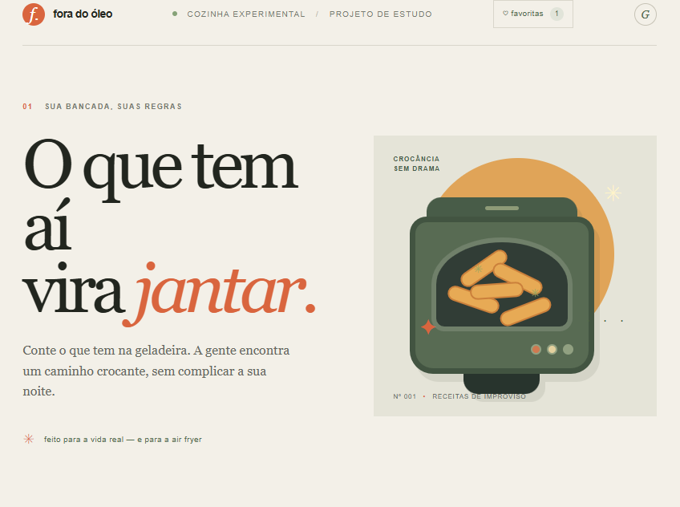
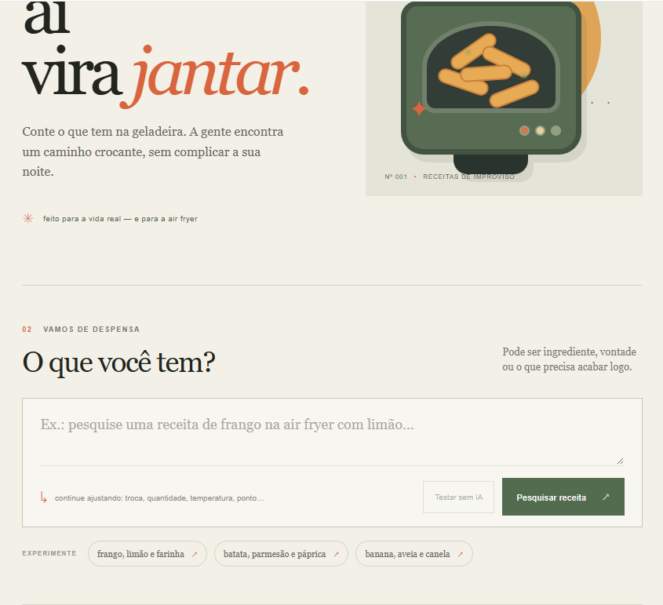

# Fora do Óleo

Um pequeno laboratório para aprender IA generativa, agentes e MCP criando receitas para air fryer.

## Prévia

## Rodar localmente

1. Instale as dependências com `npm install`.
2. Crie uma chave da Gemini API no Google AI Studio.
3. Copie `.env.example` para `.env.local` e coloque sua chave em `GEMINI_API_KEY`.
4. Rode `npm run dev` e abra `http://localhost:3000`.

O botão de favoritas guarda respostas no `localStorage` do navegador atual. Reabrir uma favorita não chama o modelo. Não há conta nem sincronização entre dispositivos ainda.

O botão **Testar sem IA** chama o servidor MCP de reserva: primeiro tenta a API pública TheMealDB (com cache de uma hora); se ela não tiver correspondência, tenta o pequeno catálogo local. Se a chamada ao Gemini falhar por cota ou indisponibilidade, o app tenta a mesma reserva automaticamente. Receitas de reserva vindas da TheMealDB mantêm as instruções originais e avisam que não foram pensadas especificamente para air fryer.

Nunca coloque a chave em componentes React ou em variáveis com prefixo `NEXT_PUBLIC_`: chaves de provedor devem ficar no servidor.

## O que acontece quando você pede uma receita

1. O formulário do navegador envia os ingredientes para `POST /api/recipe`.
2. O Route Handler do Next.js valida o pedido e lê a chave guardada no servidor.
3. O Gemini pesquisa receitas na web e recebe a lista de ferramentas MCP disponíveis.
4. O modelo pode chamar `buscar_receitas_air_fryer` ou `converter_medida_culinaria`; o Route Handler executa as chamadas MCP e devolve os resultados ao Gemini.
5. A resposta aparece na conversa. Nas mensagens seguintes, `previous_interaction_id` mantém o contexto da receita para pedidos como “não tenho açúcar” ou “converta para colheres”.

## Conceitos que aparecem aqui

- **Modelo:** Gemini recebe o pedido e escreve a resposta.
- **Agente:** a lógica do servidor envia o pedido ao modelo, executa a ferramenta que ele escolher e envia o resultado de volta para ele.
- **MCP:** padroniza a conexão cliente-servidor e a descrição/chamada das ferramentas. `src/lib/recipe-mcp.ts` define o servidor e `src/app/api/recipe/route.ts` contém o cliente.
- **Skills:** `skills/air-fryer-cook/SKILL.md` ensina o agente a montar receitas; `skills/recipe-adjuster/SKILL.md` orienta substituições e conversões. `src/lib/skill-loader.ts` escolhe qual instrução carregar a partir do pedido. O arquivo organiza as regras; quem as aplica ainda é o modelo.
- **Harness de avaliação:** `evals/recipe-agent.cases.json` registra cenários reproduzíveis e `scripts/evals/recipe-agent-harness.mjs` executa cada um contra o servidor MCP e o seletor de skills, sem chamar Gemini nem gastar cota. Rode `npm run eval:agent` após mudar uma ferramenta, skill ou regra de seleção (requer Node.js 22.18+). O harness confere comportamento determinístico; ele não mede a qualidade do texto gerado pelo modelo.

O transporte MCP está em memória para o primeiro exercício: os dois lados rodam dentro do app e não exigem outro processo. A pesquisa web usa a ferramenta Google Search oferecida pela Gemini API; o catálogo inicial fica no servidor MCP. Depois podemos mover o servidor para um processo separado por stdio/HTTP e trocar o catálogo local por uma fonte de receitas própria.

## Aprender com o harness

Abra `evals/recipe-agent.cases.json` para ver os casos de avaliação. Cada cenário pode conferir ferramentas MCP anunciadas, uma chamada e sua resposta, ou quais skills são carregadas para um pedido. Adicione um caso quando mudar o comportamento esperado. O comando é local e não precisa de `GEMINI_API_KEY`.
